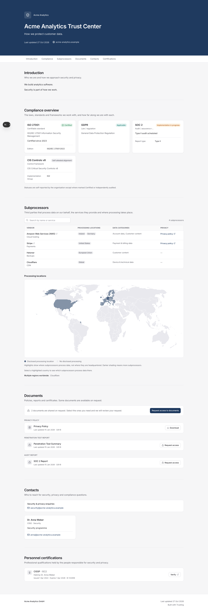
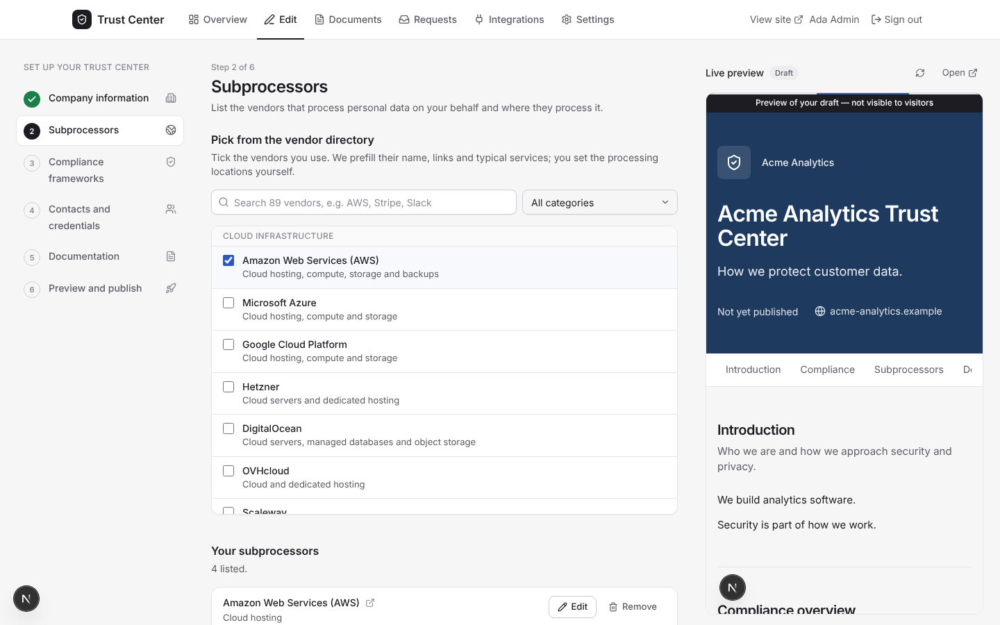
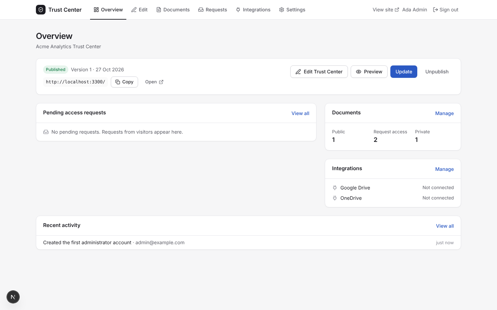
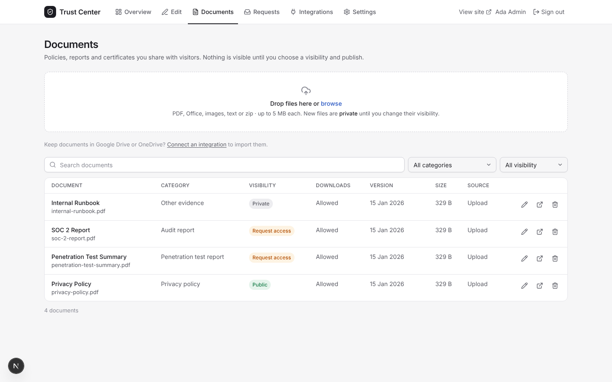
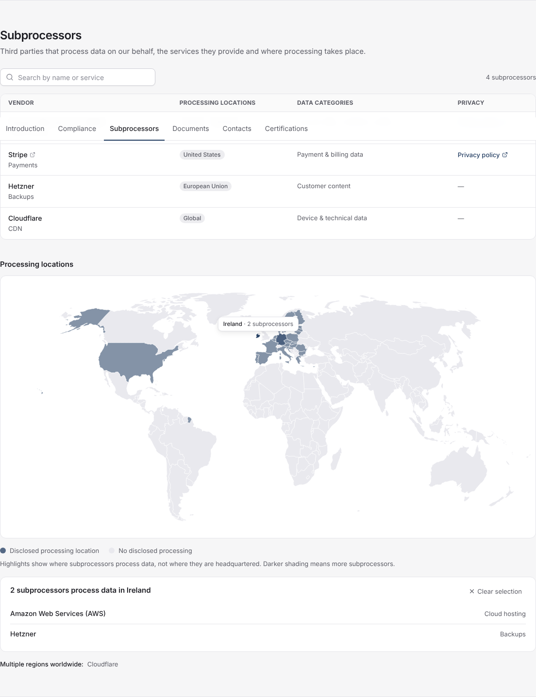

# Trusting

**An open-source, self-hosted Trust Center.** Publish a credible security and compliance page
for your company in an afternoon, keep confidential documents behind an approval flow, and own
the whole thing on your own server.

[Quick start](#quick-start) · [How it works](#how-it-works) · [Install guide](docs/install.md) ·
[Configuration](docs/configuration.md) · [Security](SECURITY.md) · [Contributing](CONTRIBUTING.md)

## What is a Trust Center?

When a prospect's security team asks "are you SOC 2 certified, where is our data hosted, who are
your subprocessors, can we see your pen-test report?", a Trust Center is the page you send them.
It is a public, always up-to-date overview of your security and compliance posture: the
frameworks you follow, the vendors you rely on, where data lives, who to contact, and the policies
and reports you are willing to share, some publicly and some only after approval.

Commercial Trust Center products exist, but they are priced for enterprises and keep your
documents on someone else's platform. Trusting is for **small and mid-sized teams** (startups,
agencies, SaaS companies, public-sector suppliers) who want the same credibility without the
subscription: one Docker Compose stack, your database, your storage.

## Features

- **Guided builder.** A six-step editor with autosave walks you through company profile and
  branding, compliance frameworks, subprocessors, documents, contacts and certifications. A live
  preview shows the public page as you type.
- **Honest compliance badges.** Each framework carries an explicit status: *Certified*, *Audited*,
  *Self-attested alignment*, *Implementation in progress* or *Applicable*. Nothing implies a
  certification you do not have.
- **Subprocessor directory and map.** Pick vendors from a built-in catalogue (or add your own),
  record what they do and where they host, and show it on a world map of hosting locations.
- **Documents with three visibility levels.** *Public* (anyone can open), *On request* (visitors
  ask, you approve, they get a time-limited link) and *Private* (administrators only). Uploads
  are type-checked by content and stored under random keys in private storage; every download is
  authorised and streamed by the app.
- **Access requests.** Visitors request specific documents with their name, company and email.
  You approve or reject from the admin area; approvals create an expiring grant (default 14 days)
  that can be revoked at any time. Requesters are notified by email when SMTP is configured, or
  you copy the link and send it yourself.
- **Draft and publish.** Edit freely; the public page only changes when you press *Publish*.
  Publications are kept as immutable snapshots, and unpublishing takes the page offline instantly.
- **Import from Google Drive and OneDrive.** Connect your own OAuth app and pick files straight
  from your drive. Tokens are encrypted at rest.
- **Audit log.** Sign-ins, publishing, document changes and downloads, access decisions and
  integration changes are recorded with who, when and from where.
- **Self-contained.** Next.js, PostgreSQL and any S3-compatible store (or a local folder). No
  external fonts, scripts or analytics are loaded on the public page.

## Screenshots

| Public Trust Center | Guided editor |
| --- | --- |
|  |  |

| Admin dashboard | Documents and access requests | Subprocessor map |
| --- | --- | --- |
|  |  |  |

## Quick start

You need Docker with the Compose plugin. Five minutes, no accounts anywhere.

```sh
git clone https://github.com/z-brenner/trusting.git
cd trusting
cp .env.example .env
```

Open `.env` and fill in the secrets (the full list is in [docs/install.md](docs/install.md)):

```sh
openssl rand -hex 32            # -> SESSION_SECRET
openssl rand -hex 32            # -> ENCRYPTION_KEY
openssl rand -hex 32            # -> GARAGE_RPC_SECRET and S3_SECRET_ACCESS_KEY (run it twice)
echo "GK$(openssl rand -hex 12)"   # -> S3_ACCESS_KEY_ID
openssl rand -hex 16            # -> POSTGRES_PASSWORD, and use it in DATABASE_URL
```

Then:

```sh
docker compose up -d
```

Open **http://localhost:3000/setup** to create the first administrator. Build your page, press
*Publish*, and your Trust Center is live at `http://localhost:3000`. For a real deployment put a
TLS proxy in front and set `APP_URL` (see [docs/deployment.md](docs/deployment.md)).

The stack is three containers: the app, PostgreSQL 16 and [Garage](https://garagehq.deuxfleurs.fr)
as an S3-compatible file store. You can swap Garage for AWS S3 / R2 / B2 or for a plain folder on
disk (`STORAGE_DRIVER=local`), and the database for a managed PostgreSQL;
[docs/install.md](docs/install.md) has the variants.

## How it works

**Draft vs. published.** Administrators always edit a draft. Publishing writes an immutable
snapshot that the public page renders; nothing you type is visible until you publish, and you can
unpublish at any time. The history of publications is kept.

**Document visibility.** Each document is *Public*, *On request* or *Private*. A visitor can open
a document only if **both** the published snapshot and the current draft allow it: making a
document more restrictive takes effect immediately, making it more permissive requires publishing.
Downloads use short-lived signed links and are authorised again at download time, so a revoked
grant or a changed visibility is enforced even for links already handed out.

**Access requests.** A visitor picks the *On request* documents they need and submits a short
form. Administrators see pending requests on the dashboard and approve (choosing how long the
grant lasts) or reject with a note. An approved requester receives a personal link that unlocks
exactly those documents until the grant expires or is revoked. Everything is logged.

See [docs/ARCHITECTURE.md](docs/ARCHITECTURE.md) for the technical design.

## Integrations

Documents can be imported from cloud drives instead of uploaded. Both integrations are optional
and use OAuth apps that you own; nothing works until you configure the client ID and secret.

- [Google Drive](docs/integrations/google-drive.md)
- [Microsoft OneDrive / SharePoint](docs/integrations/onedrive.md)

Email notifications for access requests use any SMTP server
([configuration](docs/configuration.md#email-optional)).

## Security

Trusting is built for handling confidential documents: scrypt password hashing, hashed opaque
session tokens, CSRF protection on every mutation, content-sniffed upload validation, private
storage with authorised streaming, AES-256-GCM encryption of integration tokens, rate limiting,
an audit log and a strict Content Security Policy. [SECURITY.md](SECURITY.md) describes the
design, how to report vulnerabilities, and a hardening checklist for operators.

## Documentation

| Guide | |
| --- | --- |
| [Install with Docker Compose](docs/install.md) | step by step, incl. external S3 / PostgreSQL and local-disk storage |
| [Configuration reference](docs/configuration.md) | every environment variable |
| [Deployment behind a proxy](docs/deployment.md) | Caddy, nginx, Traefik; TLS and upload limits |
| [Backup and restore](docs/backup-restore.md) | what to back up and how to test a restore |
| [Upgrading](docs/upgrade.md) | pulling new versions, migrations, rollback |
| [Architecture](docs/ARCHITECTURE.md) · [Design system](docs/DESIGN.md) | for contributors |

## Development

Requirements: Node.js 22, pnpm 10, PostgreSQL 16 (and `psql` for the test setup).

```sh
pnpm install
cp .env.example .env            # set DATABASE_URL to your local PostgreSQL, STORAGE_DRIVER=local,
                                # and generate SESSION_SECRET / ENCRYPTION_KEY
pnpm db:migrate                 # create the schema (prisma migrate dev)
pnpm dev                        # http://localhost:3000/setup
```

Tests: `pnpm test` (Vitest unit tests, uses a `trustcenter_test` database) and `pnpm test:e2e`
(Playwright, starts its own server and mocks the Google/Microsoft APIs). `pnpm lint` and
`pnpm typecheck` run in CI together with a production build. See
[CONTRIBUTING.md](CONTRIBUTING.md).

## Project status

Trusting is young software. The table says what is implemented and how it has been verified,
and what you need to bring yourself.

| Area | Status | Notes |
| --- | --- | --- |
| Setup, login, sessions, administrators | Implemented, unit + e2e tested | |
| Guided editor with autosave and live preview | Implemented, e2e tested | |
| Publish / unpublish with snapshot history | Implemented, unit + e2e tested | |
| Public Trust Center page incl. subprocessor map | Implemented, e2e tested | |
| Document upload, visibility, signed downloads | Implemented, unit + e2e tested | Allow-list of document types; `MAX_UPLOAD_MB` |
| Access requests, grants, revocation | Implemented, e2e tested | |
| Audit log | Implemented | |
| Docker image and Compose stack | Implemented; production build, migration entrypoint and health check verified on the host (no Docker daemon was available to run `docker build` itself) | MinIO was replaced by Garage because MinIO's images are no longer published; any S3-compatible service works |
| Google Drive import | Implemented, e2e tested against a mock Google API | Needs your own Google OAuth client; not yet exercised against production Google by the maintainers |
| OneDrive import | Implemented, e2e tested against a mock Microsoft Graph | Needs your own Entra app registration; same caveat |
| Email notifications | Implemented | Needs SMTP credentials; without them the admin UI shows the link to copy |
| Multi-instance / horizontal scaling | Not a goal | Rate limits are per process; one instance per organisation |
| Multiple organisations per installation | Not supported | One installation = one Trust Center |

## License

Apache License 2.0, see [LICENSE](LICENSE). The bundled object store, Garage, is a separate
project licensed under AGPL-3.0; it runs as its own container and is not part of this codebase.
